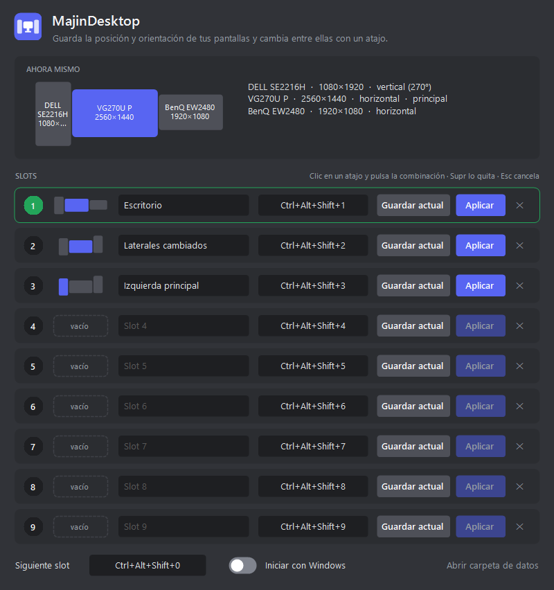

<p align="center"></p>

<h1 align="center">MajinDesktop</h1>

<p align="center">Guarda cómo tienes colocadas tus pantallas y cambia de una disposición a otra con un atajo de teclado.</p>

<p align="center"></p>

## Qué hace

- **9 slots de pantallas.** Cada slot guarda la posición y la orientación (horizontal o vertical) de cada pantalla, y por tanto cuál es la principal. Para guardar uno, colócalas en *Configuración › Pantalla* y pulsa *Guardar actual*.
- **Atajos globales.** `Ctrl+Alt+Shift+1…9` aplican cada slot y `Ctrl+Alt+Shift+0` pasa al siguiente. Se cambian haciendo clic en la caja y pulsando la combinación. Si otra aplicación ya usa una combinación, la caja se pone en rojo.
- **Reconoce cada monitor.** Identifica cada pantalla por modelo y puerto, así que no se lía aunque Windows cambie los números DISPLAY1/2/3.
- **Aviso en pantalla.** Al cambiar de slot aparece un aviso pequeño con un dibujo de la disposición. No te quita el foco.
- **Bandeja del sistema.** Con clic izquierdo abres la configuración. Con clic derecho, un menú con tus slots (el activo lleva ✓) para guardar, cambiar de slot, iniciar con Windows o salir.
- **Se actualiza sola.** Si la tienes instalada, al arrancar y cada 6 horas mira si hay una release nueva en este repositorio. Si la hay, la instala en silencio y se vuelve a abrir. La versión portable solo avisa, y el menú de la bandeja tiene *Buscar actualizaciones*.
- **Muy ligero.** La app pesa unos 70 KB, ocupa unos 4 MB de RAM y no gasta CPU mientras espera un atajo.
- **Línea de comandos** para Stream Deck o tus propios scripts:

  ```
  MajinDesktop.exe --list          pantallas actuales y slots guardados
  MajinDesktop.exe --save 3        guarda la disposición actual en el slot 3
  MajinDesktop.exe --apply 3       aplica el slot 3
  MajinDesktop.exe --validate 3    comprueba si Windows aceptaría el slot 3, sin aplicarlo
  ```

No cambia la resolución, la frecuencia ni la escala, y tampoco enciende ni apaga pantallas. Si un slot no incluye una pantalla que ahora está conectada, esa pantalla se queda donde está. Si choca con otra, se mueve a la derecha.

Lo que viene después está en el [plan de mejoras](ROADMAP.md): estados de escritorio completos (iconos, fondo, audio, modo TV) y un organizador visual de accesos directos de juegos.

## Descarga

En [Releases](https://github.com/MajinSander/MajinDesktop/releases/latest) están:

| Archivo | Para qué |
|---|---|
| `MajinDesktop-Setup-x.y.z.exe` | **Instalador (recomendado).** Se instala para tu usuario, sin pedir permisos de administrador. Crea el acceso del menú Inicio y, si quieres, el inicio con Windows. Se desinstala desde *Aplicaciones instaladas*. |
| `MajinDesktop.exe` | Versión portable. Se abre sin instalar nada. |

Solo necesita .NET Framework 4.8, que ya viene con Windows 10 (desde la versión 1903) y con Windows 11.

## Datos

Los slots se guardan en `%APPDATA%\MajinDesktop\config.ini`, un archivo de texto que puedes abrir y editar. Si defines la variable `MAJINDESKTOP_DATA`, la app usa esa carpeta en su lugar, lo que sirve para hacer pruebas.

## Compilar

```
pwsh -File build.ps1 -Version 0.1.0
```

Hace falta el SDK de .NET 8 o superior. Se usa su compilador Roslyn contra los ensamblados de .NET Framework 4.8 que trae Windows, así que el código puede usar C# moderno y el resultado no depende de ningún runtime extra. Los ejecutables quedan en `dist\`.

Al publicar una release en GitHub, el workflow `release.yml` compila la app y adjunta los dos ejecutables.

---

**English:** MajinDesktop saves the position and orientation of your monitors in 9 slots and switches between them with global hotkeys. It's a tray app of about 70 KB that uses about 4 MB of RAM. Download the installer or the portable exe from [Releases](https://github.com/MajinSander/MajinDesktop/releases/latest). The [roadmap](ROADMAP.md) explains how it will grow into a full desktop state manager.
